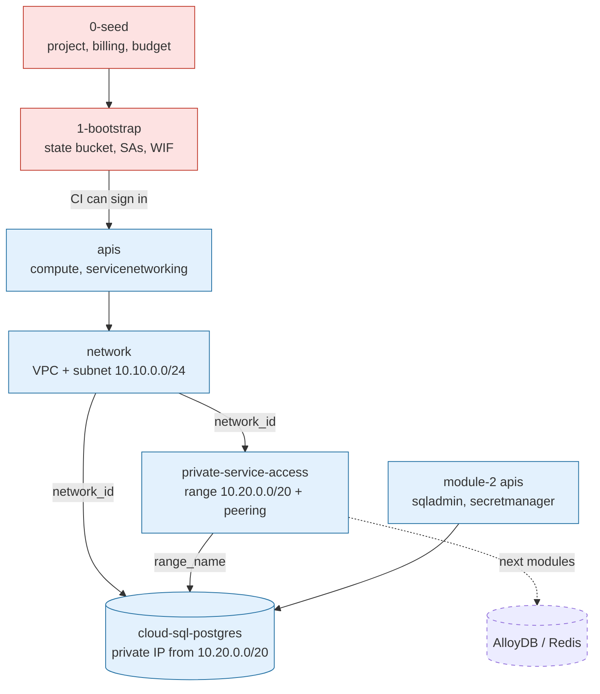
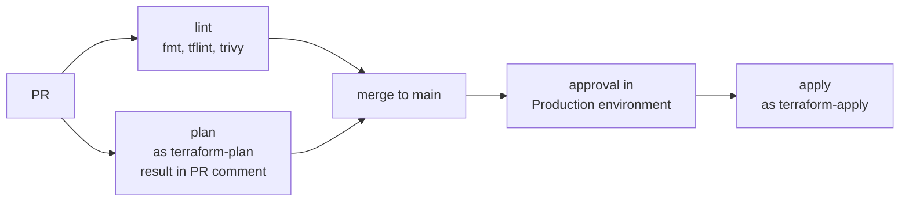

# gcp-learning

Hands-on project for the "Databases in GCP" course: a GCP project built the way production
infrastructure is built. Terraform/Terragrunt, every change through a pull request, applied by
GitHub Actions after manual approval, no service account keys.

Setup from scratch: [docs/SETUP.md](docs/SETUP.md).

## What creates what

| Folder | Resources | Applied by |
|---|---|---|
| [`databases/module-0/0-seed`](databases/module-0/0-seed) | Project, billing link, budget alert | Admin, locally |
| [`databases/module-0/1-bootstrap`](databases/module-0/1-bootstrap) | APIs, state bucket, `terraform-plan` / `terraform-apply` SAs, Workload Identity Federation | Admin, locally |
| [`databases/module-1/apis`](databases/module-1/apis) | Compute and Service Networking APIs | CI |
| [`databases/module-1/network`](databases/module-1/network) | VPC `learning-vpc`, subnet `10.10.0.0/24` | CI |
| [`databases/module-1/private-service-access`](databases/module-1/private-service-access) | Reserved range `10.20.0.0/20` + peering with Google services | CI |
| [`databases/module-2/apis`](databases/module-2/apis) | Cloud SQL Admin and Secret Manager APIs | CI |
| [`databases/module-2/cloud-sql-postgres`](databases/module-2/cloud-sql-postgres) | Cloud SQL PostgreSQL 17, private IP only, database `app`, postgres password in Secret Manager | CI |
| [`modules/`](modules) | Terraform code the stacks above call | - |
| [`root.hcl`](root.hcl) | Shared provider and GCS state backend for all stacks | - |
| [`.github/workflows/`](.github/workflows) | `lint` and `plan` on PRs, `apply` after merge | - |

## Dependencies

Each stack reads the outputs of the one it depends on, so they are created top to bottom
and destroyed bottom to top.

Red: applied by an admin locally. Blue: applied by CI. Dashed: next course modules.

## How a change gets applied

